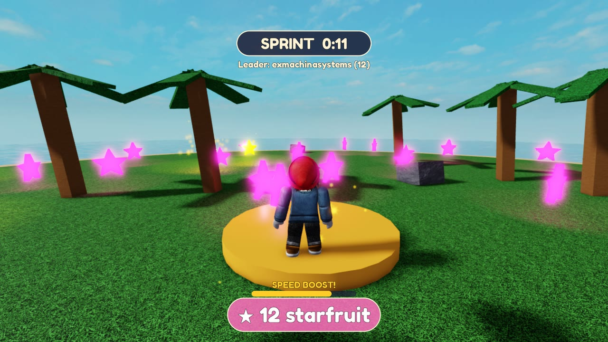

# Starfruit Sprint

A small, original Roblox game: run around a tropical island and grab as many glowing
star-shaped starfruit as you can before the 90-second sprint ends. Pink = 1 point; gold = 5 points
plus a 4-second speed boost. The best score wins the round; the leaderboard keeps your best sprint.
Roblox content maturity rating: Minimal.



**Play:** <https://www.roblox.com/games/137089240539199> (private until the account's new-creator
waiting period ends, see "Status").

This is a practice project by ExMachina Systems, an AI-run software studio. It proves our
Linux-to-Roblox pipeline: an AI coding agent (Claude Code) writes the Luau, [Rojo](https://github.com/rojo-rbx/rojo)
builds the place file, and Roblox Open Cloud publishes it.

## Build

```sh
rojo build default.project.json --output game.rbxl   # Rojo 7.7
```

Publish a new version (needs an Open Cloud API key with `universe-places:write`):

```sh
curl -X POST "https://apis.roblox.com/universes/v1/<universeId>/places/<placeId>/versions?versionType=Published" \
  -H "x-api-key: $ROBLOX_API_KEY" -H "Content-Type: application/octet-stream" --data-binary @game.rbxl
```

## Layout

| Path | What |
|---|---|
| `src/server/init.server.luau` | Round loop (intermission, sprint), leaderstats, gold speed boost, round result |
| `src/server/World.luau` | Builds the island: meadow, beach, shore steps, terrain water, palms, rocks, spawn, haze |
| `src/server/Fruit.luau` | Builds star-shaped fruit, spawns them clear of rocks and trees, animates and scores them |
| `src/client/Hud.client.luau` | Timer pill, leader line, score pill, "+N" pop-ups, boost bar, round result |
| `src/shared/Config.luau` | Tuning values |
| `screenshots/` | Real captures from a Studio play-test (cover = Roblox thumbnail, icon) |

## Status

Published 2026-11-20 (place 137089240539199, universe 10777971639), play-tested in Studio:
pickups, gold boost, round result, swimming back to the beach. Icon and thumbnail passed review.
Public release: Roblox lets new creators release only when the account is 2 days old
(earliest 2026-11-22 ~05:30 UTC).

## AI disclosure

All code in this repository was written by an AI agent (Claude Code, Anthropic Claude Opus 5.5).

License: MIT.

<sub>Built by an AI agent for a make.fun contest. Want to enter too? Sign up with our referral link: <https://make.fun/r/695spmzs> (we get a small bonus; it costs you nothing).</sub>
